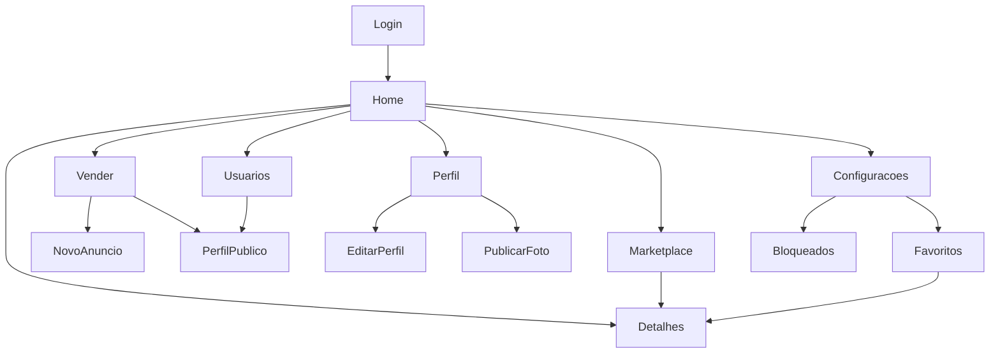

# Interface, sitemap e wireframes

Estes wireframes são reconstruções esquemáticas da implementação atual, criadas em 04/11/2026. Não são screenshots, aprovação prévia de design ou arquivos Figma. O produto é Android nativo. A validação com o usuário e a comparação visual em dispositivo permanecem pendentes.

## Sitemap completo

[Fonte editável](modelos/sitemap.mmd) — [imagem resumida](imagens/sitemap.svg) — [grafo implementado](../front/projeto_que_vou_apagar_dando_der/app/src/main/res/navigation/nav_graph.xml).

## Inventário de telas e componentes

| Tela / diálogo | Estrutura esquemática | Componentes essenciais |
| --- | --- | --- |
| [dialog_edit_profile](../front/projeto_que_vou_apagar_dando_der/app/src/main/res/layout/dialog_edit_profile.xml) | [Imagem](imagens/wire-dialog_edit_profile.svg) | ImageView: avatar_preview, MaterialButton: select_avatar, TextInputEditText: name_input, TextInputEditText: email_input, TextInputEditText: bio_input, ProgressBar: save_progress |
| [dialog_new_post](../front/projeto_que_vou_apagar_dando_der/app/src/main/res/layout/dialog_new_post.xml) | [Imagem](imagens/wire-dialog_new_post.svg) | MaterialButton: select_photo, ImageView: photo_preview, EditText: description_input, ProgressBar: post_progress, TextView: post_error |
| [dialog_new_product](../front/projeto_que_vou_apagar_dando_der/app/src/main/res/layout/dialog_new_product.xml) | [Imagem](imagens/wire-dialog_new_product.svg) | EditText: title_input, EditText: price_input, EditText: category_input, EditText: model_input, EditText: image_input, EditText: video_input |
| [dialog_profile_media](../front/projeto_que_vou_apagar_dando_der/app/src/main/res/layout/dialog_profile_media.xml) | [Imagem](imagens/wire-dialog_profile_media.svg) | ImageView: media_image, VideoView: media_video, TextView: media_error |
| [fragment_bloqueados](../front/projeto_que_vou_apagar_dando_der/app/src/main/res/layout/fragment_bloqueados.xml) | [Imagem](imagens/wire-fragment_bloqueados.svg) | ImageButton: blocked_back, Button: block_user_button, ProgressBar: blocked_progress, TextView: blocked_message, Button: blocked_retry, RecyclerView: blocked_list |
| [fragment_configuracoes](../front/projeto_que_vou_apagar_dando_der/app/src/main/res/layout/fragment_configuracoes.xml) | [Imagem](imagens/wire-fragment_configuracoes.svg) | ProgressBar: settings_progress |
| [fragment_favoritos](../front/projeto_que_vou_apagar_dando_der/app/src/main/res/layout/fragment_favoritos.xml) | [Imagem](imagens/wire-fragment_favoritos.svg) | View: header_background_favoritos, ImageView: btn_back_favoritos, TextView: txt_title_favoritos, ImageView: img_search_favoritos, ProgressBar: favorites_progress, TextView: favorites_message |
| [fragment_home](../front/projeto_que_vou_apagar_dando_der/app/src/main/res/layout/fragment_home.xml) | [Imagem](imagens/wire-fragment_home.svg) | EditText: feed_search, ImageView: btn_notifications, MaterialButton: model_filter, MaterialButton: category_filter, MaterialButton: tag_filter, ImageButton: btn_chat_home |
| [fragment_login](../front/projeto_que_vou_apagar_dando_der/app/src/main/res/layout/fragment_login.xml) | [Imagem](imagens/wire-fragment_login.svg) | TextView: login_heading, TextView: login_subtitle, TextInputLayout: name_layout, TextInputEditText: name_input, CheckBox: seller_check, TextInputLayout: email_layout |
| [fragment_marketplace](../front/projeto_que_vou_apagar_dando_der/app/src/main/res/layout/fragment_marketplace.xml) | [Imagem](imagens/wire-fragment_marketplace.svg) | View: header_background, ImageView: btn_back_marketplace, TextView: txt_title_marketplace, ImageView: img_store_marketplace, TextView: txt_tipage, ImageView: img_arrow_1 |
| [fragment_perfil](../front/projeto_que_vou_apagar_dando_der/app/src/main/res/layout/fragment_perfil.xml) | [Imagem](imagens/wire-fragment_perfil.svg) | ImageButton: find_users, ImageButton: header_share, ImageButton: profile_menu, ProgressBar: profile_progress, TextView: profile_message, MaterialButton: retry_button |
| [fragment_product_details](../front/projeto_que_vou_apagar_dando_der/app/src/main/res/layout/fragment_product_details.xml) | [Imagem](imagens/wire-fragment_product_details.svg) | MaterialButton: back_button, ProgressBar: product_progress, TextView: product_message, MaterialButton: retry_button, TextView: product_title, ImageView: product_image |
| [fragment_users](../front/projeto_que_vou_apagar_dando_der/app/src/main/res/layout/fragment_users.xml) | [Imagem](imagens/wire-fragment_users.svg) | EditText: search_input, ImageView: search_button, TextView: filter_label, ProgressBar: users_progress, TextView: users_message, MaterialButton: retry_button |
| [fragment_vender](../front/projeto_que_vou_apagar_dando_der/app/src/main/res/layout/fragment_vender.xml) | [Imagem](imagens/wire-fragment_vender.svg) | ImageView: add_product, MaterialButton: all_sellers, TextView: directory_message, ProgressBar: directory_progress, RecyclerView: sellers_list, HorizontalScrollView: product_filters |

## Estados visuais e adaptação

Listas devem distinguir carregamento, sucesso, erro e vazio; ações mutantes devem desabilitar envio duplicado e exibir resultado. LoginFragment e ViewModels implementam estados assíncronos; revisar todas as telas durante o roteiro. Recursos values-w600dp, values-w1240dp e values-land adaptam dimensões, mas não comprovam testes de tablet ou desktop. Máscaras devem ser aplicadas apenas a campos que as exigem, sem inventar CPF, telefone ou checkout inexistentes no escopo.

## Prototipação navegável

A referência navegável disponível é o APK gerado a partir do código. Seguir Login → Home → Marketplace → Detalhes → Favoritos e Usuários → Perfil. Os SVGs acima descrevem blocos e não reproduzem fidelidade visual. **Pendente:** projeto Figma publicado, link compartilhável, prints reais e validação de fidelidade. Não há protótipo Figma criado nesta entrega.