# Modelagem de processos e software

Os modelos abaixo documentam o MVP existente. Relações representadas não adicionam checkout, pagamento, chat, notificações ou operações de aceitar/recusar solicitações que não tenham endpoint implementado. As imagens SVG são resumos de leitura; as fontes Mermaid abaixo são os diagramas completos.

## Sitemap Android

O ponto inicial é Login. A barra inferior organiza os módulos autenticados; detalhes recebem product_id e perfil público recebe userId. O diagrama resume também ações disparadas por botões, não apenas actions XML.

[Fonte CASE editável](modelos/sitemap.mmd) · [Visão resumida SVG](imagens/sitemap.svg)

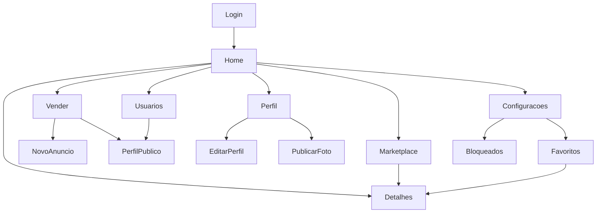

## Arquitetura funcional

Autenticação estabelece sessão; vendedor cria anúncios consultáveis no marketplace; publicações compõem o feed. Favoritos, perfis e bloqueios dependem da identidade autenticada.

[Fonte CASE editável](modelos/funcional.mmd) · [Visão resumida SVG](imagens/funcional.svg)

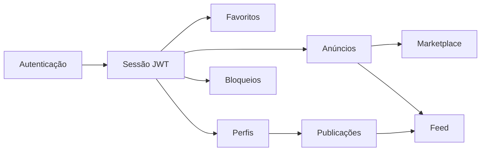

## Arquitetura técnica

Android troca JSON com Express via proxy HTTPS da Render. O banco é MySQL externo em produção; SQLite volátil serve apenas à demonstração. Fotos exigem armazenamento persistente. TLS do banco depende do provedor.

[Fonte CASE editável](modelos/tecnica.mmd) · [Visão resumida SVG](imagens/tecnica.svg)

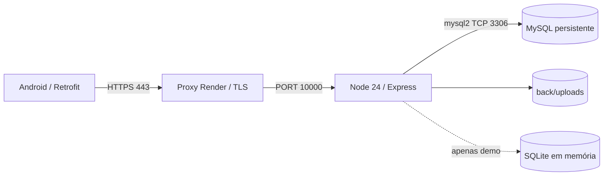

## Distribuição MVC

MVC é distribuído: View Android, controllers HTTP e models SQL no backend. ViewModels Android gerem estado de apresentação; não são os models de persistência Node.

[Fonte CASE editável](modelos/mvc.mmd) · [Visão resumida SVG](imagens/mvc.svg)

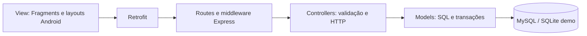

## Cadeia de valor

A cadeia de valor aproxima compradores e vendedores pela descoberta de peças e gestão de anúncios. Não há transação financeira implementada.

[Fonte CASE editável](modelos/macroprocesso.mmd) · [Visão resumida SVG](imagens/macroprocesso.svg)

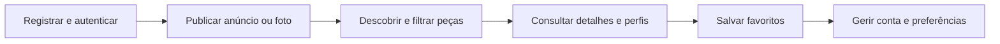

## Fluxo de anúncio

Anunciar exige sessão e papel vendedor. Entradas inválidas retornam 400; ausência de sessão 401; papel insuficiente 403. Somente após persistência a API retorna 201.

[Fonte CASE editável](modelos/fluxograma.mmd) · [Visão resumida SVG](imagens/fluxograma.svg)

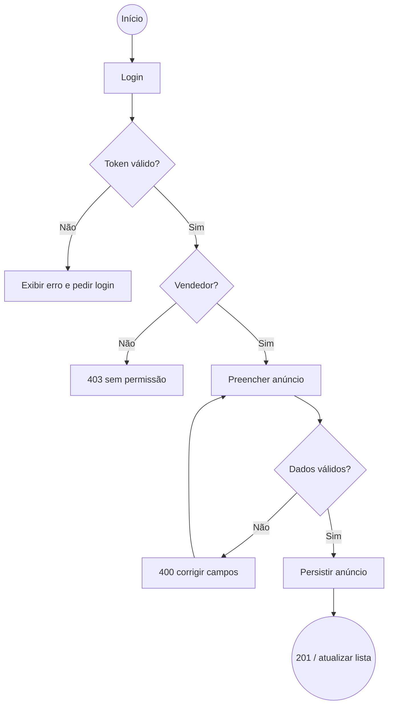

## Contexto do sistema

Comprador e vendedor são atores; Render e operador sustentam execução. MySQL e uploads são recursos externos ao aplicativo móvel. Serviços de pagamento não integram o escopo.

[Fonte CASE editável](modelos/contexto.mmd) · [Visão resumida SVG](imagens/contexto.svg)

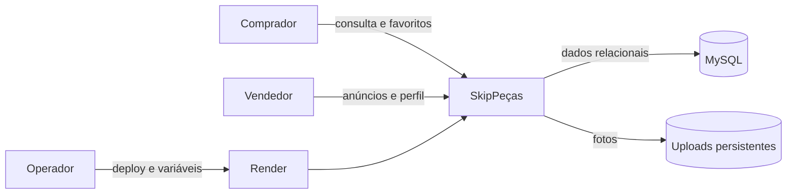

## Casos de uso

Atores podem compartilhar comportamentos sem herança de classes implementada. O catálogo de especificações por tela está em PRODUCAO_TECNICA.md.

[Fonte CASE editável](modelos/casos-uso.mmd) · [Visão resumida SVG](imagens/casos-uso.svg)

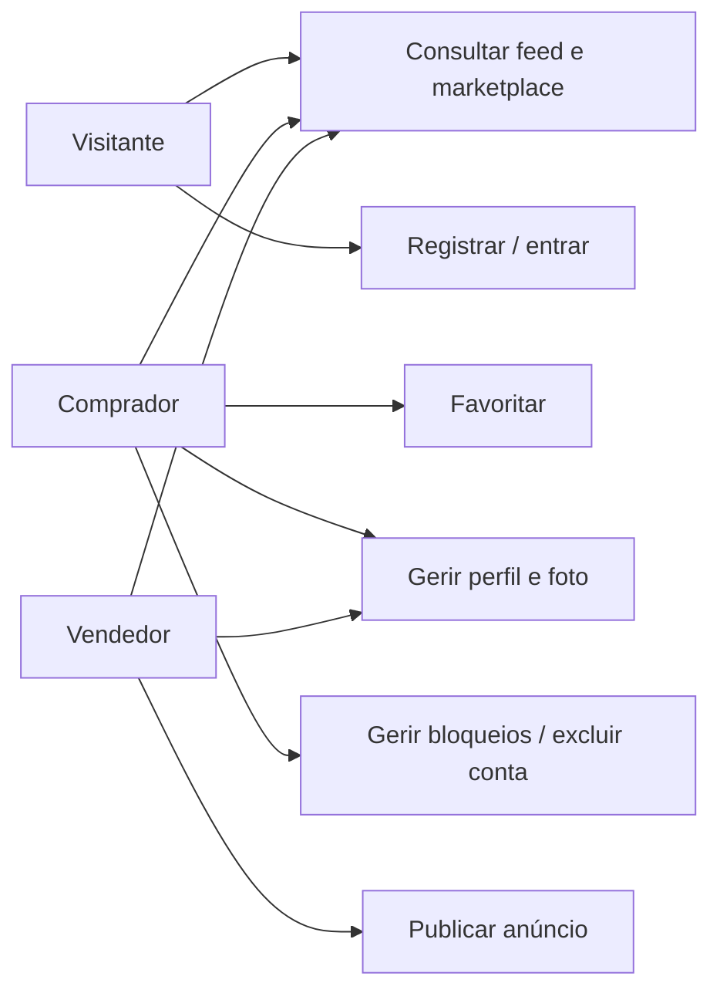

## Estado de sessão

A máquina representa a sessão. Exclusão e expiração invalidam o acesso. O campo product_requests.status admite pendente/aceita/recusada no schema, mas não foi modelado como fluxo operacional entregue por ausência de API de decisão.

[Fonte CASE editável](modelos/estados.mmd) · [Visão resumida SVG](imagens/estados.svg)

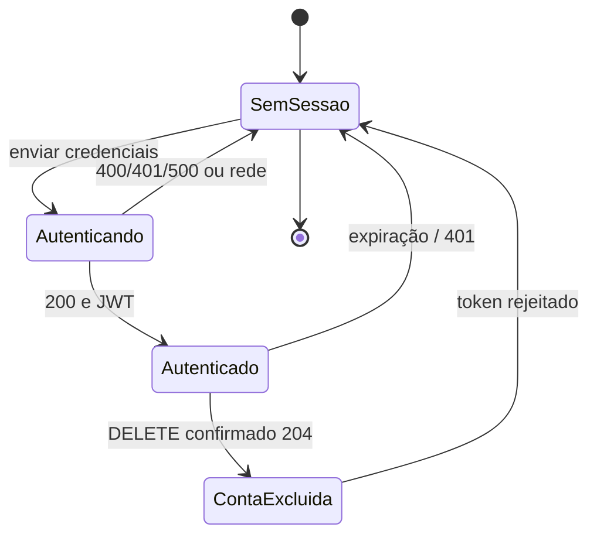

## Operação de bloqueio

Bloqueio valida a identidade, bloqueia linhas em ordem consistente e realiza INSERT idempotente dentro de transação. Em falha há rollback e release; nenhuma consulta recebe IDs concatenados.

[Fonte CASE editável](modelos/operacao.mmd) · [Visão resumida SVG](imagens/operacao.svg)

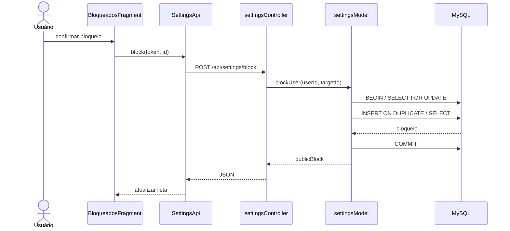

## DFD nível 0

O processo global recebe credenciais, filtros e alterações, e devolve conteúdo, sessão e feedback. O depósito agrega as persistências detalhadas no nível 1.

[Fonte CASE editável](modelos/dfd-nivel0.mmd) · [Visão resumida SVG](imagens/dfd-nivel0.svg)

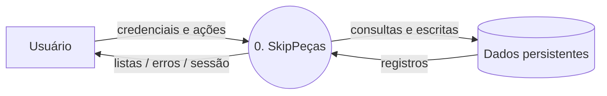

## DFD nível 1

A decomposição separa identidade, conteúdo, relações e arquivos. user_follows e product_requests existem no banco; isso não implica interface completa de gestão dessas relações.

[Fonte CASE editável](modelos/dfd-nivel1.mmd) · [Visão resumida SVG](imagens/dfd-nivel1.svg)

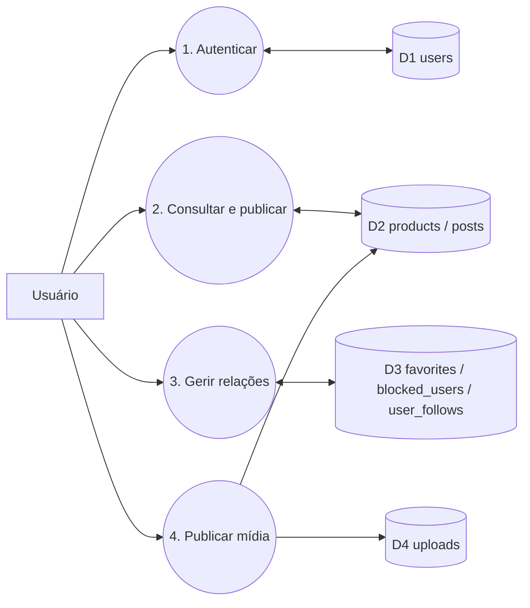

## Classes e módulos do domínio

User, Product, Post e Favorite são conceitos e DTOs; a API usa módulos funcionais, não classes JavaScript com herança artificial. UserModel e SettingsModel representam exports reais. O dicionário de dados contém todos os atributos e tipos SQL.

[Fonte CASE editável](modelos/classes.mmd) · [Visão resumida SVG](imagens/classes.svg)

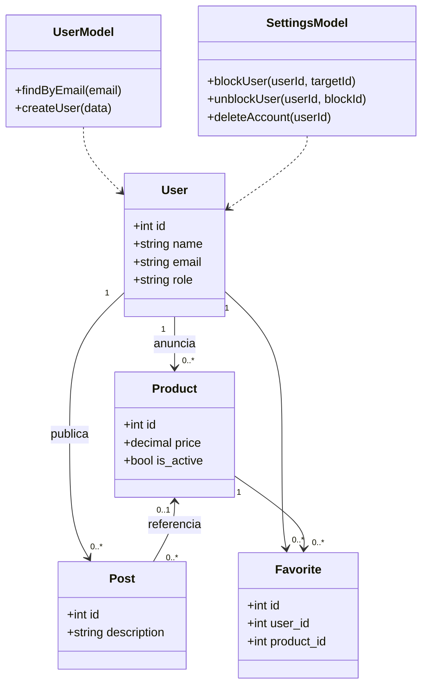

## Entidade relacionamento

O DER foi derivado do schema consolidado; FK product_id de posts é opcional, demais FKs são obrigatórias. user_follows possui PK composta. Consultar o dicionário para nulabilidade, CHECKs, índices e cascatas exatos.

[Fonte CASE editável](modelos/der.mmd) · [Visão resumida SVG](imagens/der.svg)

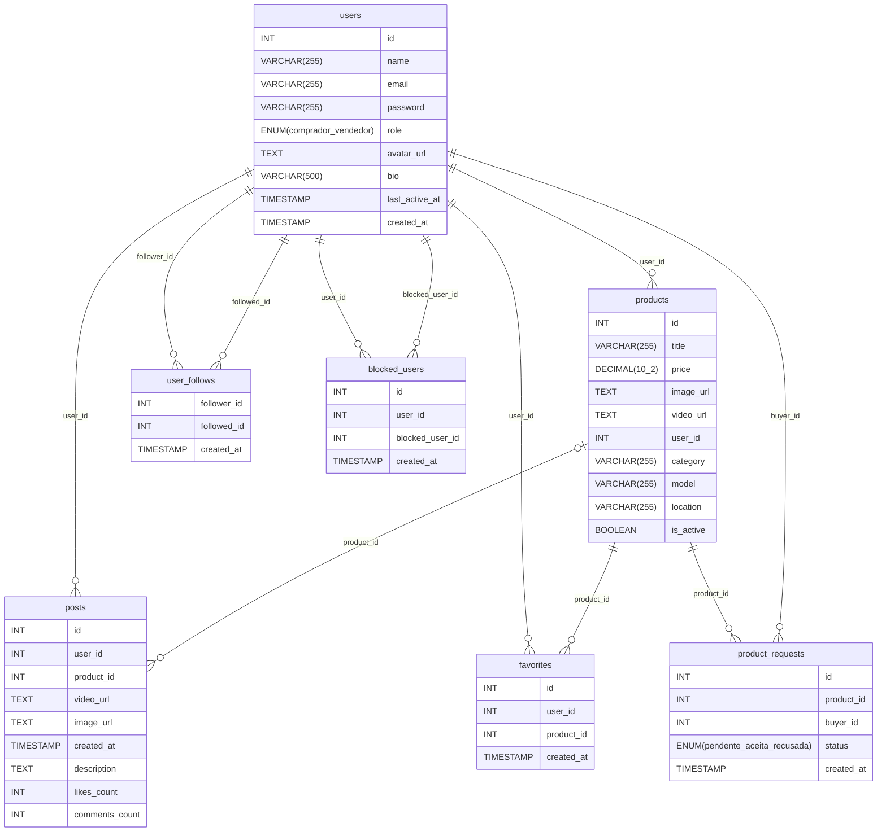

## BPMN: publicação de anúncio

[Modelo BPMN 2.0 importável](modelos/publicar-anuncio.bpmn). As raias distinguem Usuário e API. O evento inicial leva ao preenchimento, a API valida sessão/papel/dados, o gateway exclusivo decide validade e segue para persistir/sucesso ou rejeitar/fim de erro. O fluxo de erro exige nova tentativa do usuário. As conexões dentro do mesmo pool são fluxos de sequência; não são mensagens entre participantes.

## Ferramenta CASE e reprodução

Fontes `.mmd` são modelos textuais Mermaid versionados, editáveis em ferramentas compatíveis e renderizados nas páginas Markdown que suportam Mermaid. O `.bpmn` é XML BPMN 2.0 com DI para importação em modelador compatível. `python3 scripts/gerar_modelos.py` regenera resumos SVG, inventário de wireframes e dicionário diretamente das fontes locais, sem serviços externos. Os resumos SVG não substituem o conteúdo semântico dos modelos completos. Não foi alegado uso de Figma ou de licença de ferramenta comercial.